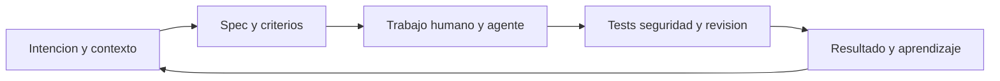

Cuando una organización quiere empezar a trabajar con IA, una de las primeras decisiones suele ser comprar licencias, habilitar modelos o arrancar un piloto de coding agents.

Y está bien. Pero, preparando con Diego Rodríguez Varela la charla para NetCoreConf Madrid 2026, acabamos volviendo una y otra vez a una pregunta: **¿qué cambia realmente en el sistema de desarrollo cuando añadimos esas herramientas?**

Porque una cosa es que una persona pueda generar código más rápido. Otra distinta es que el equipo entregue mejor, que los cambios se puedan revisar y que la organización aprenda de lo que ocurre después.

Para aterrizar la conversación usamos un caso público, [AI-SDLC-26/ai-sdlc-journey](https://github.com/AI-SDLC-26/ai-sdlc-journey). Es una demo pequeña, pero precisamente por eso permite seguir una idea desde la especificación hasta el código sin confundirla con una plataforma de producción.

## Una pregunta antes de hablar de herramientas

Hagamos un ejercicio. Mañana quitamos la licencia o cambiamos de proveedor. ¿Qué queda?

Si lo único que permanece son algunos prompts que cada persona recuerda, probablemente hemos comprado una experiencia útil, pero no hemos construido mucha capacidad compartida.

Si quedan especificaciones más claras, decisiones registradas, tests, instrucciones reutilizables y una forma de medir el resultado, entonces hay algo que el equipo puede conservar y mejorar aunque cambie el modelo.

Esto no es una crítica a Copilot ni a ninguna otra herramienta. Es una forma de separar tres niveles:

| Nivel | Pregunta | Señal que buscaría |
| --- | --- | --- |
| Herramienta | ¿La persona recibe ayuda en una tarea? | Menos fricción al trabajar |
| Flujo | ¿El equipo mueve mejor el cambio? | Menos esperas, retrabajo y sorpresas |
| Sistema | ¿La organización aprende y puede repetirlo? | Decisiones trazables y cambios seguros |

Una mejora en el primer nivel no garantiza una mejora en los otros dos. Podemos generar código más rápido y terminar con más PRs esperando revisión. Podemos ahorrar tiempo escribiendo una función y perderlo intentando entender una issue ambigua.

[DORA plantea en su informe de 2025](https://dora.dev/research/2025/dora-report/) que la IA actúa como un amplificador de las fortalezas y debilidades existentes en una organización. Me parece una forma útil de mirar el problema, no una ley que garantice un resultado para todos los equipos. Si los requisitos, los permisos o la revisión ya son un problema, añadir IA no hace que desaparezcan.

## El contexto también es arquitectura

Cuando hablamos de arquitectura solemos pensar en servicios, APIs, bases de datos y despliegues. Pero si queremos que personas y agentes trabajen juntos, también importa dónde está la intención y cómo se encuentra.

En la charla organizamos ese contexto en cinco capas:

1. **Intención:** qué problema intentamos resolver, para quién y con qué resultado esperado.
2. **Decisiones:** límites, alternativas descartadas, ADRs y responsables.
3. **Procedimiento:** instrucciones, skills y workflows que explican cómo trabajar.
4. **Evidencia:** tests, comprobaciones de seguridad, observabilidad y métricas.
5. **Código:** implementación, contratos y dependencias.

El código sigue siendo fundamental. Lo que cambia es que ya no puede ser la única fuente de verdad operativa.

Pensemos en alguien que llega por primera vez a un servicio. Si una decisión importante solo existe en la cabeza de otra persona, esa persona nueva no puede consultarla. Para un agente ocurre lo mismo. Y si encuentra tres documentos contradictorios, darle más contexto no ha resuelto el problema: ahora tiene tres posibles respuestas.

Por eso creo que una spec o un ADR son útiles cuando hacen explícita una decisión que necesitamos entender o comprobar. No porque todas las tareas deban producir más Markdown. Una spec obsoleta es contexto incorrecto con apariencia de autoridad.

Antes de montar RAG o un grafo de conocimiento, preguntaría algo más básico: ¿qué fuente manda?, ¿quién la mantiene?, ¿cómo sabemos que sigue vigente? Si no podemos responder eso, retrieval solo nos ayudará a encontrar antes la misma confusión.

## El handoff es donde se ve el sistema

Una tarea no empieza y termina en el IDE. Hay una intención, criterios de aceptación, decisiones de implementación, código, revisión y una consecuencia en el producto o en la operación.

Una representación simplificada sería esta:



El dibujo no dice que cada fase necesite un agente. Tampoco significa que despliegue y observación desaparezcan: son fuentes de señales para comprobar qué pasó después del cambio.

La pregunta en cada transición es si la siguiente persona o herramienta recibe lo necesario para continuar. ¿La issue explica el problema? ¿La spec tiene criterios verificables? ¿La revisión sabe qué riesgo debe aceptar? ¿Lo que hemos aprendido vuelve a la siguiente tarea?

Si aceleramos solo una estación, podemos mover el cuello de botella en lugar de eliminarlo. Para mí, esta es la diferencia entre medir una herramienta y entender el flujo completo.

## No es autonomía total, es delegación diseñada

Una de las conversaciones más interesantes de la charla es la de los permisos. Solemos hablar de si confiamos o no en un agente, pero esa pregunta es demasiado general.

No es lo mismo leer un repositorio público que leer datos de clientes. Tampoco es lo mismo proponer un cambio en una rama que hacer merge o desplegar en producción. La acción puede parecer similar, pero cambian el alcance, el impacto y la facilidad de volver atrás.

Por eso me gusta pensar en la autonomía como un presupuesto de riesgo. No es una fórmula para calcular una puntuación exacta, sino una conversación sobre **qué puede hacer el agente, dónde puede hacerlo y cómo recuperamos el control**.

Un contrato sencillo para una tarea podría responder:

```yaml
objetivo: proponer un cambio para una tarea concreta
contexto: spec y archivos relevantes
permitido: leer y proponer cambios en una rama
prohibido: acceder a secretos o desplegar
evidencia: tests y resumen de limites
decision_humana: revisar y aceptar el cambio
```

Es un ejemplo para ordenar preguntas, no un estándar ni una configuración que por sí sola imponga permisos. La parte importante es comprobar que la plataforma, las credenciales y las herramientas hacen cumplir esos límites.

Si una instrucción dice «no tocar producción» pero el agente dispone de una credencial que sí puede hacerlo, tenemos una intención escrita, no una frontera de seguridad. El mínimo privilegio debe vivir en los sistemas que conceden acceso, no en esperar que el modelo se autocontrole.

Y con la evidencia ocurre algo parecido. Que el agente explique que todo está bien puede ayudar a entender su propuesta, pero no sustituye a ejecutar tests, revisar el diff o comprobar seguridad. Un cambio pequeño y reversible puede admitir una revisión ligera. Un cambio de alto impacto puede necesitar más evidencia, una persona responsable y un rollback real.

## Un caso concreto: de la issue a la tabla de usuarios

Aquí es donde el repositorio de ejemplo resulta útil. [AI-SDLC Journey](https://github.com/AI-SDLC-26/ai-sdlc-journey) contiene una API ASP.NET Core, una SPA con React y Vite, instrucciones, especificaciones y pruebas.

En lugar de quedarnos en la lista de carpetas, podemos seguir una tarea concreta. La instantánea que usamos para preparar la charla corresponde al commit [`9ea3b9d` del 3 de octubre de 2026](https://github.com/AI-SDLC-26/ai-sdlc-journey/tree/9ea3b9d7fb356b17d51a05cfc4c837ff12a4bdf6):

1. La [spec de la tabla de usuarios](https://github.com/AI-SDLC-26/ai-sdlc-journey/blob/9ea3b9d7fb356b17d51a05cfc4c837ff12a4bdf6/specs/001-users-table/spec.md) parte de una issue y aclara comportamientos: ver nombre, rol y estado, mostrar un estado vacío y redirigir a quien no esté autenticado.
2. El [plan](https://github.com/AI-SDLC-26/ai-sdlc-journey/blob/9ea3b9d7fb356b17d51a05cfc4c837ff12a4bdf6/specs/001-users-table/plan.md) concreta la solución: una ruta protegida en la SPA, un endpoint `/api/users`, datos en memoria y una tabla HTML sin añadir otra librería.
3. El [contrato de API](https://github.com/AI-SDLC-26/ai-sdlc-journey/blob/9ea3b9d7fb356b17d51a05cfc4c837ff12a4bdf6/specs/001-users-table/contracts/users-api.yaml) documenta la autenticación bearer, la respuesta y el modo vacío para validar ese escenario de forma determinista.
4. El plan identifica implementación y pruebas para API y SPA. Eso permite preguntar si los escenarios de la spec realmente tienen evidencia, en vez de asumirlo porque hay un documento.

Hay un detalle que me parece importante: en esa instantánea la spec sigue marcada como **Draft**. El material del proyecto recoge resultados de pruebas históricos, pero eso no equivale a afirmar que acabamos de ejecutar la CI ni que todo siga pasando hoy.

También hay que decir qué no demuestra el ejemplo. Es una demo local-first con usuarios mock y credenciales de demostración. En la revisión de esa instantánea no localizamos un gateway de modelos, presupuesto por consumidor ni un bucle conectado a feedback real de producción. Tampoco verificamos de extremo a extremo los permisos efectivos de cada agente.

Eso no convierte el repositorio en una mala demo. Significa que debemos separar **lo implementado**, **lo documentado como intención** y **lo que no hemos encontrado**. Y no encontrar algo en una revisión no equivale a haber hecho una auditoría de seguridad completa.

## ¿Cuándo tiene sentido un gateway?

Cuando empezamos a hablar de varios modelos y agentes aparece enseguida una caja nueva en el diagrama: el gateway.

Puede ser útil para centralizar identidad, cuotas, routing, políticas y telemetría. Pero también introduce operación, configuración, coste, latencia y decisiones sobre qué datos se registran.

Para una única aplicación y un único modelo puede ser complejidad que todavía no necesitamos. Si varios equipos consumen distintos proveedores y necesitamos atribuir consumo o aplicar políticas comunes, la conversación cambia. La decisión debería partir de esa necesidad, no de querer añadir una capa más a la arquitectura.

Lo mismo con las métricas. Tokens, llamadas y latencia ayudan a entender actividad y coste, pero no dicen por sí solos si el cambio aportó valor. Necesitamos relacionarlos con algo más: cambios aceptados y mantenidos, tiempo de revisión, retrabajo, defectos, incidentes o una hipótesis validada.

Y también importa la percepción del equipo. Si la gente teme que registrar retrabajo se interprete como un fracaso, el dashboard puede acabar mostrando lo que queremos ver en lugar de lo que está pasando.

## Medir antes de declarar victoria

Hay un dato de la charla que ayuda a poner esta conversación en contexto. En un [ensayo controlado de METR sobre herramientas disponibles a principios de 2025](https://metr.org/Early_2025_AI_Experienced_OS_Devs_Study-paper.pdf), 16 desarrolladores open source experimentados realizaron 246 tareas en proyectos maduros que conocían bien. En ese entorno concreto, permitir herramientas de IA se asoció con un 19 % más de tiempo de finalización.

No creo que la conclusión sea «la IA ralentiza a los desarrolladores». El estudio tiene una población, unos proyectos y unas herramientas concretas. Lo que sí nos recuerda es que una intuición de productividad puede fallar y que conviene medir el flujo propio antes de celebrar o descartar una iniciativa.

Para un piloto elegiría una tarea repetible y de bajo riesgo. Definiría su spec, sus permisos, la evidencia necesaria y cómo compararemos los resultados. Después miraría tiempo, calidad, retrabajo, seguridad, coste y percepción del equipo. Y acordaría de antemano qué nos llevaría a continuar, cambiar el experimento o pararlo.

Parar con evidencia no tiene por qué ser un fracaso. También puede ser la decisión que evita escalar una hipótesis que todavía no funciona.

## Lo que me llevaría al lunes

Si tuviera que convertir todo esto en un primer paso, no empezaría comprando una plataforma ni creando un agente para cada fase.

Empezaría por una tarea concreta:

1. Identificar el problema, el owner y el criterio de éxito.
2. Poner junto al código el contexto y las restricciones que necesita quien vaya a trabajar en ella.
3. Acotar herramientas y permisos según el riesgo.
4. Definir qué evidencia se revisará y quién toma la decisión.
5. Observar qué ocurrió después y actualizar la spec, el ADR o el backlog si hemos aprendido algo.

A partir de ahí podemos ampliar la delegación cuando haya razones y evidencia para hacerlo.

La licencia puede resolver una fricción individual. Pero el AI SDLC que queremos construir es el sistema completo que rodea esa ayuda: el contexto que compartimos, los límites que hacemos cumplir y la forma en que comprobamos y aprendemos de los cambios.
