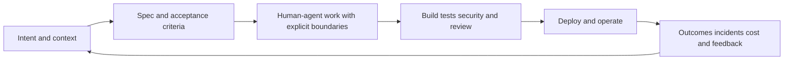

Comprar licencias, habilitar modelos o probar un coding agent suele ser la parte fácil. Lo difícil empieza cuando queremos que la IA participe en el ciclo de desarrollo real de una organización: que entienda el contexto, trabaje con límites claros, produzca cambios verificables y aprenda de lo que ocurre después del merge.

Ese salto no se resuelve instalando otra herramienta en el IDE. Es un problema de **arquitectura del sistema de desarrollo**.

En la charla de NetCoreConf Madrid 2026 lo resumí así: la IA puede acelerar una interacción, pero el valor organizativo aparece cuando conectamos contexto, flujo, controles y aprendizaje. Este artículo desarrolla esa idea y la aterriza en un repositorio de ejemplo que se puede inspeccionar y ejecutar localmente: [AI-SDLC-26/ai-sdlc-journey](https://github.com/AI-SDLC-26/ai-sdlc-journey).

## De una herramienta a un sistema

Conviene separar tres niveles que a menudo mezclamos:

| Nivel | Pregunta | Qué tendría que mejorar |
| --- | --- | --- |
| Herramienta | ¿La persona recibe ayuda? | Menos fricción en una tarea |
| Flujo | ¿El equipo entrega mejor? | Menos esperas, retrabajo y sorpresas |
| Sistema | ¿La organización aprende? | Cambios seguros y decisiones trazables |

Un copiloto vive principalmente en el primer nivel. Un AI SDLC conecta los tres. Si el agente propone código más deprisa pero la revisión sigue siendo el cuello de botella, quizá solo hayamos movido la espera. Si el cambio llega a producción pero nunca vuelve como evidencia al backlog, tampoco hemos cerrado el ciclo.

Por eso la pregunta no es «¿cuántos agentes tenemos?», sino **qué transiciones del SDLC queremos mejorar y cómo sabremos que han mejorado**.

## El contexto es una pieza de arquitectura

Un agente solo puede razonar sobre lo que encuentra, interpreta y puede comprobar. El repositorio, por tanto, no es únicamente código: también contiene contexto operativo.

Para que una tarea sea delegable, el agente —y la persona que revisa— necesita reconstruir al menos cinco cosas:

- **Intención:** qué problema resolvemos y para quién.
- **Restricciones:** qué queda fuera y qué no se debe tocar.
- **Decisiones:** qué alternativas se eligieron y quién es responsable.
- **Criterios y ejemplos:** cómo reconocer el resultado esperado.
- **Evidencia:** qué pruebas o comprobaciones permiten aceptar el cambio.

Esto no significa convertir cada cambio en una montaña de Markdown ni construir un grafo del código por reflejo. Una especificación ayuda cuando reduce ambigüedad; un ADR sirve cuando conserva una decisión que alguien podría necesitar revisar. Si esos documentos no tienen owner o están desactualizados, versionamos contexto incorrecto.

La regla práctica es empezar por el contexto mínimo útil y observable. Añadamos sistemas de búsqueda, RAG o grafos solo cuando un problema real de descubrimiento lo justifique.

## Delegar es diseñar límites, no regalar autonomía

La autonomía es un presupuesto de riesgo. Depende de la acción, de su alcance y de lo reversible que sea. Leer un archivo, proponer un parche, modificar una configuración de producción y publicar un cambio externo no deberían recibir los mismos permisos ni los mismos gates.

Un contrato de tarea puede hacer explícito:

- qué resultado se busca;
- qué repositorios, archivos y herramientas puede usar el agente;
- qué operaciones requieren aprobación humana;
- qué pruebas y evidencias debe devolver;
- cuándo debe detenerse y escalar una duda.

El principio de mínimo privilegio también aplica al agente. Y que el agente explique por qué cree que algo funciona no sustituye a una prueba independiente.

## Una arquitectura que devuelve información al trabajo

Una forma sencilla de visualizar el sistema es seguir la tarea desde su intención hasta el feedback de producción:

El diagrama no implica que todo deba automatizarse. Representa las preguntas que no podemos perder entre un handoff y el siguiente: ¿seguimos resolviendo el problema correcto?, ¿qué evidencia hace falta?, ¿quién acepta el riesgo residual?, ¿qué aprendimos al operar el cambio?

La verificación debe ser proporcional al impacto. Un cambio pequeño puede requerir pruebas enfocadas y una revisión ligera; uno de alto riesgo puede exigir análisis de amenazas, aprobación explícita y una estrategia de rollback. Los tests elevan la confianza, pero no demuestran por sí solos que un cambio sea seguro ni que mejore el resultado de usuario.

## Gobernar modelos y coste sin confundir actividad con valor

Cuando una organización incorpora varios modelos y agentes, necesita saber qué se usa, dónde, con qué permisos y a qué coste. Un gateway o plano de control puede ayudar a centralizar selección de modelos, cuotas, límites y atribución.

Pero medir tokens o llamadas solo mide actividad. No nos dice si el equipo entregó antes, si bajó el retrabajo o si los cambios fueron mejores. Para evaluar un piloto hace falta definir un denominador ligado al resultado: coste por cambio aceptado, tiempo hasta una entrega validada, defectos o intervención humana, según el flujo.

Tampoco conviene empezar por una plataforma enorme. Primero elijamos una tarea repetible y de bajo riesgo, establezcamos una comparación razonable y acordemos de antemano qué resultado permitiría continuar, cambiar el enfoque o parar.

## Un ejemplo deliberadamente acotado

El repositorio público [AI-SDLC-26/ai-sdlc-journey](https://github.com/AI-SDLC-26/ai-sdlc-journey) ayuda a discutir estas ideas con artefactos concretos. Es una demo local-first con una API ASP.NET Core y una SPA React/Vite; su README describe autenticación JWT de demostración, endpoints protegidos, tests para API y SPA e instrucciones para ejecutarlos.

También incluye una especificación del flujo de usuarios —[plan y contratos de `001-users-table`](https://github.com/AI-SDLC-26/ai-sdlc-journey/tree/main/specs/001-users-table)— junto con tareas y material de planificación. Eso permite recorrer un ciclo pequeño: intención, especificación, implementación, pruebas y revisión.

El límite importa tanto como la capacidad: los usuarios son datos mock, las credenciales son conocidas y el propio repositorio se presenta como demo. No es una plataforma de agentes lista para producción ni demuestra por sí sola gobierno empresarial, coste por consumidor, permisos efectivos o feedback operativo. Que esos elementos no aparezcan en el árbol revisado tampoco equivale a una auditoría de seguridad; simplemente marca preguntas que requerirían evidencia adicional.

Ese tipo de honestidad hace que una demo sea más útil, no menos. Podemos separar lo que ya está materializado de lo que todavía es una hipótesis y proponer incrementos pequeños, reversibles y con criterio de salida.

## Por dónde empezaría el lunes

1. Elegiría un único caso repetible, de bajo riesgo y con un owner.
2. Escribiría el resultado esperado, los límites y la evidencia mínima.
3. Compararía el flujo con y sin asistencia, sin atribuir cada mejora a la IA de antemano.
4. Revisaría calidad, retrabajo, seguridad, coste y percepción del equipo.
5. Actualizaría el contexto y decidiría explícitamente: continuar, cambiar o parar.

El objetivo no es maximizar autonomía ni desplegar más agentes. Es diseñar un SDLC capaz de trabajar con IA: con contexto accesible, delegación acotada, evidencia verificable y un bucle que devuelva lo aprendido al siguiente cambio.

**La licencia puede reducir una fricción. La arquitectura del sistema determina si esa ayuda se convierte en una capacidad sostenible.**
